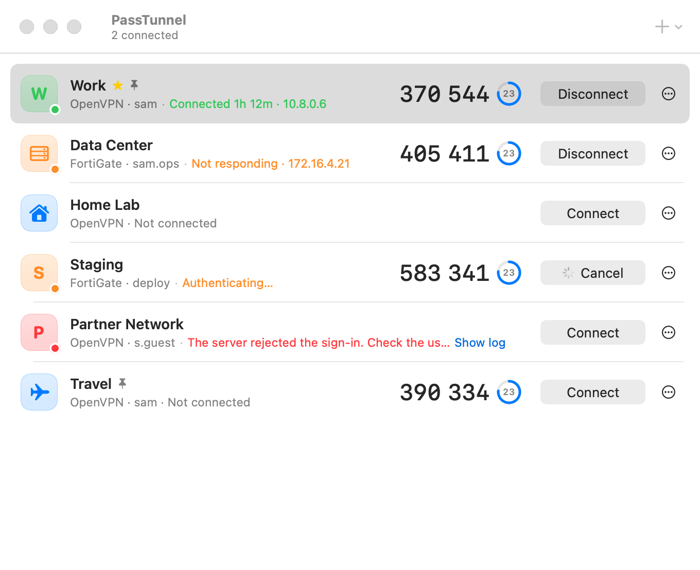
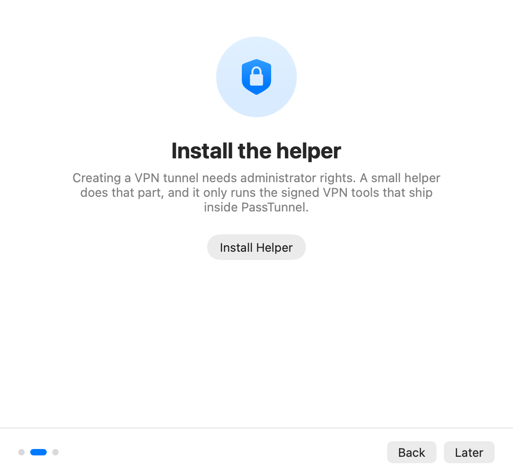
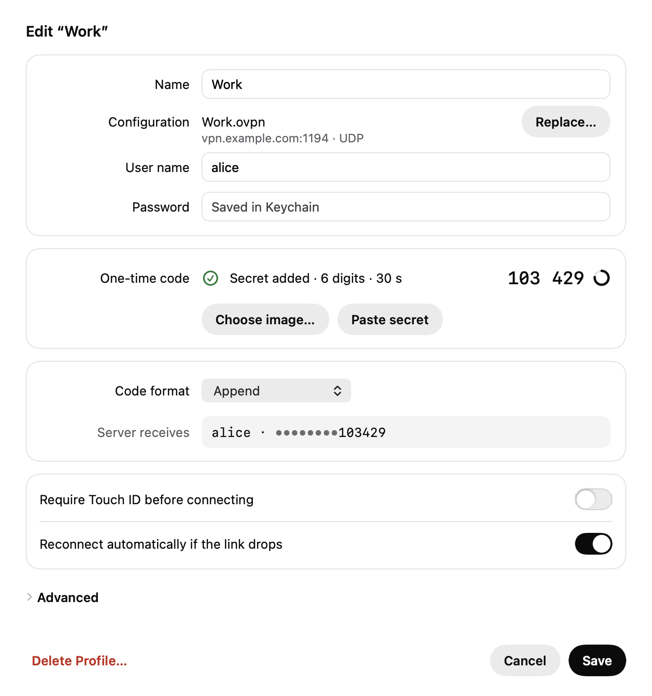
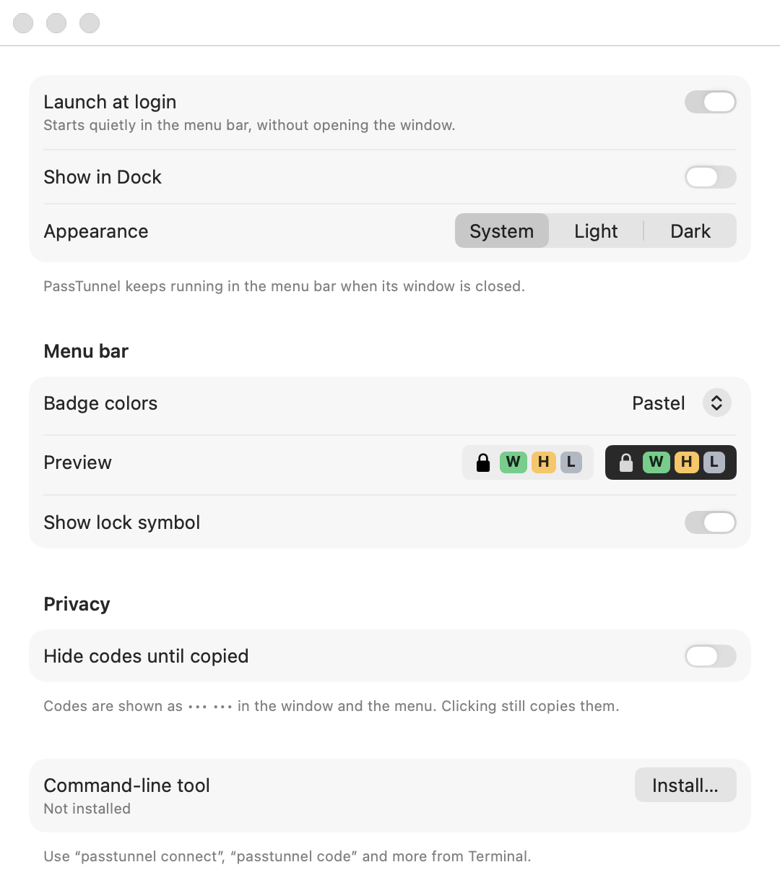

<div align="center">

# PassTunnel

**Connect your VPN without ever typing a one-time code again.**

PassTunnel is an open-source macOS app for OpenVPN and FortiGate SSL VPN. It keeps your TOTP
secret in the Keychain and fills in the current code (and your password) every time you connect.

[](#install)
[](LICENSE)
[](Package.swift)
[](https://github.com/passtunnel/passtunnel/actions/workflows/ci.yml)
[](https://scorecard.dev/viewer/?uri=github.com/PassTunnel/passtunnel)
[](https://www.bestpractices.dev/projects/15779)
[](https://www.bestpractices.dev/projects/15779)

<picture>
  <source media="(prefers-color-scheme: dark)" srcset="docs/images/main-dark.png">
  
</picture>

[Website](https://passtunnel.github.io/) ·
[Features](#features) ·
[Install](#install) ·
[Quick start](#quick-start) ·
[Code format](#configuring-the-code-format) ·
[CLI](#command-line) ·
[AI assistants](#use-with-ai-assistants-mcp) ·
[FAQ](#faq) ·
[Security](SECURITY.md) ·
[Türkçe](#türkçe)

</div>

---

## Features

**One-time codes, handled**

- **No more typing codes.** The TOTP secret lives in the macOS Keychain; PassTunnel generates the
  code and sends it with your password when you click Connect. If 5 seconds or less are left in
  the current window, it waits for a fresh code instead of racing the clock (a setting, on by
  default). A code that was already sent is never sent again.
- **Any format your server expects.** Append, prepend, `password:code`, `password,code`, or a custom
  template with any literal text, or send the code separately (OpenVPN static challenge, FortiGate
  OTP field). See [Configuring the code format](#configuring-the-code-format).
- **Authenticator-style main window.** Every profile shows its live code in large digits with a
  countdown ring. Click to copy; the clipboard is cleared again after 1 minute (or 30 seconds, or
  2 minutes, in Settings), unless you copied something else meanwhile. Codes can be hidden until
  copied.
- **QR import.** Drop a screenshot of your provider's QR code, choose an image or paste from the
  clipboard. Digits, period and algorithm (SHA-1/256/512) are read from the `otpauth://` link.
  Pasting a Base32 secret or an `otpauth://` link works too.
- **Auto-type (optional, off by default).** With global shortcuts on, ⌃⌥C types the current code into
  the focused field (also in the menu bar menu), for web portals and other places that still ask for it. Needs Accessibility
  permission, which is only requested when you turn the feature on.
- **Confirm with Touch ID (optional, per profile).** Touch ID or your Mac password before connecting
  and before showing codes (the command line can also set it to ask before connecting only); the saved
  secrets are then encrypted with a key in the Mac's Secure Enclave, so a one-click connect needs you,
  not just your unlocked Mac.

**VPN client**

- **OpenVPN and FortiGate SSL VPN**, using bundled, signed copies of `openvpn` and `openfortivpn`.
  Nothing else to install.
- **Menu bar badges.** One colored badge per pinned or active profile (letter, icon or both), five
  color palettes, and an alert when a connection drops unexpectedly.
- **Stays connected.** Optional auto-reconnect with backoff, a health check host inside the VPN,
  reconnect after wake, and a reminder before a server-side session limit runs out.
- **Several VPNs at once**, each with its own status, log and settings.
- **Shareable profiles.** Export a `.passtunnel` file for your team. It never contains passwords,
  TOTP secrets or user names.
- **Command-line tool.** `passtunnel connect`, `passtunnel code -c`, `--json` output, stable exit
  codes and shell completions: the same features as the app.
- **Works with AI assistants.** `passtunnel mcp` is an MCP server, so Claude Code, Claude Desktop
  and other MCP clients can check your VPNs, read logs and diagnose problems. Read-only unless
  you allow connecting, and it never hands out passwords, secrets or codes.
- **No sudoers rule, no admin password at every connect.** A small privileged helper, registered
  through macOS's own `SMAppService` and approved once, runs only the VPN tools signed and shipped
  inside the app, with sanitized configurations. See [SECURITY.md](SECURITY.md).
- **English and Turkish** user interface (follows your macOS language).

## How it works

```
PassTunnel.app ──XPC──▶ PassTunnelHelper (root) ──▶ bundled openvpn / openfortivpn
  │  (code-signature checked)                             │
  ├─ Keychain: password + TOTP secret                     └─ management socket (OpenVPN),
  └─ ~/Library/Application Support/PassTunnel                log file, status ──▶ back to the app
```

1. You click **Connect**. The app reads your password and TOTP secret from the Keychain, computes
   the current code and builds what the server expects (for example `secret123456`).
2. The app hands the request to the privileged helper over XPC. The helper accepts only the signed
   PassTunnel app, checks that the profile folder belongs to you, sanitizes the OpenVPN config (or
   writes the openfortivpn config itself from typed fields) and starts the bundled tool, which it
   lets run only after checking the signature of the code that was actually loaded.
3. The app follows the connection state (OpenVPN through a management socket that only your user
   can open, FortiGate through the log) and shows it in the window and the menu bar.

The full security model, including what is *not* protected, is in [SECURITY.md](SECURITY.md). The
code layout is described in [docs/ARCHITECTURE.md](docs/ARCHITECTURE.md).

## Install

Requires **macOS 13 Ventura or later** on a Mac with **Apple silicon**.

### Download

[Download the disk image](https://github.com/PassTunnel/passtunnel/releases/latest/download/PassTunnel.dmg),
open it and drag PassTunnel to **Applications**. Launch it from there: the helper can only be
installed from the Applications folder. The app is signed with a Developer ID and notarized by
Apple. What changed is in the
[release notes](https://github.com/PassTunnel/passtunnel/releases/latest).

PassTunnel keeps itself up to date (Settings → Updates); updates are signed and checked before
they are installed. After an update, the helper is updated automatically as soon as no VPN
connection is active (only when PassTunnel runs from the Applications folder).

### Homebrew

```sh
brew trust passtunnel/tap
brew install --cask passtunnel/tap/passtunnel
```

Since Homebrew 6, casks from third-party taps load only once you trust the tap, hence the first
line. The cask also links the `passtunnel` command. Updates arrive through the app itself, so
`brew upgrade` leaves it alone unless you run `brew upgrade --greedy`.

### Build from source

You need Xcode 15.3 or later (Swift 5.10, plus `xcstringstool` for the Turkish strings) and
[Homebrew](https://brew.sh), which provides the VPN tools that get bundled into the app:

```sh
brew install openvpn openfortivpn
git clone https://github.com/passtunnel/passtunnel.git
cd passtunnel
scripts/build-app.sh                  # → build/PassTunnel.app (ad-hoc signed)
```

`build-app.sh` builds a release binary, assembles the bundle, copies `openvpn`, `openfortivpn` and
their libraries in (`scripts/bundle-tools.sh`, with their license files), compiles the helper with
the code-signature hashes of exactly these tools and libraries, and signs everything inside-out with
the hardened runtime. An ad-hoc build signs the app without library validation: an ad-hoc signature
has no Team ID, so macOS would otherwise refuse to load `Sparkle.framework` into it.

> [!IMPORTANT]
> The helper only talks to an app, and only runs tools, signed with the project's Developer ID Team ID.
> An **ad-hoc build is fine for the window, codes, QR import, profiles and the CLI, but cannot
> connect**. To connect with your own build, set `teamID` in
> [`Sources/PassTunnelShared/Identifiers.swift`](Sources/PassTunnelShared/Identifiers.swift) to your
> Team ID and sign with your certificate:
>
> ```sh
> scripts/build-app.sh --sign "Developer ID Application: Your Name (TEAMID)"
> ```
>
> Then move `build/PassTunnel.app` to `/Applications` before installing the helper.

## Quick start

On first launch PassTunnel walks you through three steps:

1. **Welcome.**
2. **Install the helper.** Click *Install Helper*, then turn PassTunnel on in **System Settings →
   General → Login Items** (macOS asks once). You can also do this later from **Settings → Helper**.
3. **Add your first VPN.**

<p align="center">
  
</p>

### Add a profile

Use the **+** button in the toolbar, or drop a file onto the window:

| You have… | Do this |
|---|---|
| An OpenVPN file (`.ovpn` / `.conf`) | **+ → Import .ovpn…** Files it references (`ca ca.crt`, `tls-auth ta.key 1`, …) are embedded automatically. |
| A FortiGate gateway | **+ → New FortiGate…** Enter host and port, then **Fetch fingerprint** to pin the gateway certificate (SHA-256). |
| A `.passtunnel` file from a colleague | Double-click it (or open it from AirDrop), or **+ → Import shared profile…** Then add your own user name, password and TOTP secret. |
| A QR code for your authenticator | **+ → Add code from QR…**, or drop the screenshot onto the window or the editor. |

Then open the profile editor (**⋯ → Edit…**):

- **Sign-in:** user name (leave empty to be asked each time) and password, saved in the Keychain.
  Under **Advanced** the password can be asked each time instead, or not used (certificate-only OpenVPN).
- **One-time code:** choose the QR code image or paste the secret (or drop the screenshot on the card),
  and compare the live code with your phone before saving. **Code format** sets how the code is sent;
  *Server receives* shows the result, with the password masked. Under **Advanced** the code can be asked
  each time or not used.

<p align="center">
  
</p>

Secrets are written to the Keychain only when you press **Save**.

### Connect

Click **Connect**. If the profile needs something that is not stored (for example, a password set to
*Ask each time*), a small sheet asks for just that, with the code already filled in.

The menu bar shows a badge for each pinned or active profile, colored by state, and offers
Connect/Disconnect and Copy Code per profile:

<p align="center">
  
  &nbsp;
  
</p>

Optional global shortcuts (**Settings → Shortcuts**, off by default): **⌃⌥V** connects or
disconnects the default profile, **⌃⌥C** copies the current code, or types it when auto-type is on.

<p align="center">
  
</p>

## Configuring the code format

Servers disagree on how the one-time code should arrive. Choose it per profile in the editor's
**Code format** popup.

**With the password** (Append, Prepend, password:code, password,code, Custom template): the code and
password are joined into one password using a template. `{password}` and `{otp}` are replaced; any other text is sent as typed. The template must
contain `{otp}`; `{password}` is optional.

With the password `secret` and the code `123456`:

| Format | Template | Sent as password |
|---|---|---|
| Append (default) | `{password}{otp}` | `secret123456` |
| Prepend | `{otp}{password}` | `123456secret` |
| Password:code | `{password}:{otp}` | `secret:123456` |
| Password,code | `{password},{otp}` | `secret,123456` |
| Custom | `{password}#{otp}` | `secret#123456` |
| Custom (code only) | `{otp}` | `123456` |

**Sent separately**: the password and the code are sent on their own:

- **OpenVPN:** as a static-challenge response (`SCRV1:…`). PassTunnel selects this automatically
  when the imported `.ovpn` contains `static-challenge`.
- **FortiGate:** in openfortivpn's separate OTP field. This is the default for new FortiGate
  profiles.

As you change the format, the editor's *Server receives* shows the result with the profile's user
name and the live code; the password is always masked.

## Command line

Install the `passtunnel` command from **Settings → General → Command-line tool**. It is a symlink to
the app binary in `/usr/local/bin`, or in `~/.local/bin` if that folder is not writable. Profile IDs
are derived from the profile name (`Work` → `work`).

```sh
passtunnel                          # status of all profiles
passtunnel connect                  # connect the default profile
passtunnel connect work             # connect a specific profile
passtunnel code work -c             # print the live code and seconds left, copy it (for 1 min by default)
passtunnel status work --json       # exit code 3 when not connected
passtunnel disconnect --all

passtunnel import ~/Downloads/work.ovpn --name Work
passtunnel secret work password     # prompts without echo
pbpaste | passtunnel secret work totp      # Base32 secret or otpauth:// link from stdin
passtunnel set work otp_mode=totp otp_template=prepend
passtunnel set work otp_template='{password}:{otp}'
passtunnel set work auto_reconnect=true health_host=10.0.0.1

passtunnel add Lab --type forti
passtunnel set lab host=203.0.113.10 port=443 username=sam

passtunnel log work -f
passtunnel helper status
passtunnel completion zsh > ~/.zfunc/_passtunnel
```

`passtunnel set ID key=value…` accepts the same settings as the editor; `passtunnel help set` lists
the keys and `passtunnel help` lists all commands.

**For scripts:** every command takes `--json` (results on stdout, errors as
`{"error":{"code":…,"message":…}}`), `--no-input` (never ask on the terminal; also
`PASSTUNNEL_NO_INPUT=1`) and `--no-auth-prompt` (fail instead of showing Touch ID);
`connect --wait --timeout 90` bounds the wait. Exit codes: `0` ok, `1` error, `2` usage, `3` not
found or not connected, `4` confirmation cancelled or not possible, `5` helper missing or outdated,
`6` connection failed, `7` timeout. The objects and codes are described in
[docs/CLI-JSON.md](docs/CLI-JSON.md).

```sh
passtunnel connect work --timeout 90 --no-input --json
passtunnel status --json | jq '.[] | select(.state == "connected") | .id'
```

## Use with AI assistants (MCP)

`passtunnel mcp` runs a [Model Context Protocol](https://modelcontextprotocol.io) server on
standard input and output, so an AI assistant can answer “is my VPN up?”, read the log of a failed
connection and tell you what is wrong.

[](https://cursor.com/en/install-mcp?name=passtunnel&config=eyJjb21tYW5kIjoiL0FwcGxpY2F0aW9ucy9QYXNzVHVubmVsLmFwcC9Db250ZW50cy9NYWNPUy9QYXNzVHVubmVsIiwiYXJncyI6WyJtY3AiXX0%3D) [](https://insiders.vscode.dev/redirect?url=vscode%3Amcp%2Finstall%3F%257B%2522name%2522%253A%2522passtunnel%2522%252C%2522command%2522%253A%2522%2FApplications%2FPassTunnel.app%2FContents%2FMacOS%2FPassTunnel%2522%252C%2522args%2522%253A%255B%2522mcp%2522%255D%257D)

[](https://glama.ai/mcp/servers/PassTunnel/passtunnel)
[](https://mcpservers.org/servers/passtunnel/passtunnel)

| Tool | What it does |
|---|---|
| `list_profiles` | Profiles with type, state, whether connecting asks for Touch ID, auto-reconnect |
| `get_status` | State, tunnel IP, since when, last error; whether the helper is installed and current |
| `get_logs` | The last lines (up to 500) of a profile's VPN log, with anything that looks like a credential redacted |
| `diagnose` | App version and location, helper state, and per profile whether config, server and saved credentials are in place |
| `connect`, `disconnect` | Only with `--allow-connect` |

**Read-only by default.** Without `--allow-connect` the assistant can look, not act. With it, it
can connect and disconnect profiles; a profile with *Confirm with Touch ID* still shows the Touch
ID prompt on your Mac, and nothing happens until you confirm. There is no tool for codes,
passwords or secrets, and none that creates, changes or deletes profiles. The server gets the same
access as the `passtunnel` command; see [SECURITY.md](SECURITY.md#mcp-server-and-automation) for
what that means, including prompt injection.

**Claude Code** (uses your shell's `PATH`; the `passtunnel` command comes with the Homebrew cask, or
from Settings → General → Command-line tool):

```sh
claude mcp add passtunnel -- passtunnel mcp                   # read-only
claude mcp add passtunnel -- passtunnel mcp --allow-connect   # may also connect and disconnect
```

Without the `passtunnel` command, use the app binary directly:

```sh
claude mcp add passtunnel -- /Applications/PassTunnel.app/Contents/MacOS/PassTunnel mcp
```

**Claude Desktop:** download `PassTunnel-mcp-<version>.mcpb` from the
[latest release](https://github.com/passtunnel/passtunnel/releases/latest) and double-click it;
Claude Desktop opens the MCP bundle and installs it. Its setting *Allow connect and disconnect*
(off by default) adds `--allow-connect`. The bundle holds only a launcher for the server built into
the app, so PassTunnel must be installed in `/Applications`; without it the server stops with an
install hint. The same bundle is the package of PassTunnel's
[MCP Registry](https://registry.modelcontextprotocol.io) entry, `io.github.PassTunnel/passtunnel`.

Or configure it by hand. Claude Desktop starts servers without your shell's `PATH`, so give the full
path. In `~/Library/Application Support/Claude/claude_desktop_config.json`:

```json
{
  "mcpServers": {
    "passtunnel": {
      "command": "/Applications/PassTunnel.app/Contents/MacOS/PassTunnel",
      "args": ["mcp"]
    }
  }
}
```

The Cursor and VS Code buttons above add the same read-only entry. Add `"--allow-connect"` to `args` to allow connecting. Other MCP clients work the same way: the
command is the app binary (or `passtunnel`), the argument `mcp`. Diagnostics go to stderr. The
server speaks MCP 2026-07-28 and, for clients that start with an `initialize` handshake,
2025-11-25 back to 2024-11-05.

## Sharing profiles

**⋯ → Share…** (or `passtunnel export work -o work.passtunnel`) writes a `.passtunnel` file with
the connection settings, appearance, code format and, for OpenVPN, the configuration file.

It never contains your password, your TOTP secret or your user name; a user name and password or
proxy credentials embedded in the OpenVPN configuration are removed too. The recipient double-clicks
it (or opens it from AirDrop) and adds their own. The embedded OpenVPN configuration can contain
certificates and keys, so the file is written with `0600` permissions; share it the way you would
share the `.ovpn` itself.

## FAQ

<details>
<summary><b>Why does PassTunnel need a privileged helper?</b></summary>

Creating a tunnel interface and changing routes and DNS requires root. Instead of asking for your
admin password at every connect or adding a sudoers rule, PassTunnel registers a small launchd
daemon with `SMAppService`, which you approve once in System Settings → General → Login Items. The
helper accepts requests only from the signed PassTunnel app, only runs the `openvpn` and
`openfortivpn` that come with it (from a root-owned copy, together with their libraries), lets them
run only after checking their signature, and rejects dangerous OpenVPN directives. Details in [SECURITY.md](SECURITY.md).
</details>

<details>
<summary><b>Where are my password and TOTP secret stored?</b></summary>

In your login Keychain, as generic passwords with the service name `PassTunnel` (accounts
`<profile-id>/password` and `<profile-id>/totp`). They do not sync to iCloud Keychain; Migration
Assistant and backups carry them to a new Mac like the rest of your login keychain. A user name and
password embedded in an imported `.ovpn` are moved there too. Profile settings and OpenVPN
configurations are in
`~/Library/Application Support/PassTunnel/`, readable only by your user. Nothing is sent anywhere
except to your VPN server.
</details>

<details>
<summary><b>Which VPN types are supported?</b></summary>

OpenVPN (OpenVPN 2.x client configurations: user/password, certificate-only and static-challenge
setups) and FortiGate SSL VPN (through openfortivpn). Other types can be added
as new backends; see [Contributing](#contributing).
</details>

<details>
<summary><b>My .ovpn file is rejected. Why?</b></summary>

The helper runs OpenVPN as root, so it refuses directives that would run scripts, load plugins, or
read and write arbitrary files: for example `up`, `down`, `plugin`, `script-security 2`, `log`,
`management` or a `ca` that points at an external file. Files referenced at import time are embedded
automatically. The error lists every offending line. The complete list is in
[SECURITY.md](SECURITY.md#openvpn-configuration-sanitizer).
</details>

<details>
<summary><b>My .p12 certificate does not load ("unsupported", "RC2-40-CBC"). Why?</b></summary>

Older PKCS#12 files are encrypted with RC2, which OpenSSL 3 and 4 only read through their legacy
provider. PassTunnel's OpenVPN loads no OpenSSL providers or modules (they would come from paths
outside the app), so such a file cannot be used as it is. Re-export it once with modern
encryption, using OpenSSL 3 (for example Homebrew's, `brew install openssl@3`; macOS's own
`/usr/bin/openssl` is LibreSSL and has no `-legacy` option):

```sh
OPENSSL="$(brew --prefix openssl@3)/bin/openssl"
"$OPENSSL" pkcs12 -legacy -in old.p12 -nodes -out temp.pem   # asks for the old password
"$OPENSSL" pkcs12 -export -in temp.pem -out new.p12          # asks for a new password
rm temp.pem                                                  # holds the unencrypted key
```

Then use `new.p12` in the configuration (or import the `.ovpn` again so it is embedded).
</details>

<details>
<summary><b>Does it work without a TOTP code?</b></summary>

Yes. Set the one-time code to *None* for a plain user/password or certificate-only VPN, or to *Ask
each time* if you use a hardware token or SMS.
</details>

<details>
<summary><b>How do I uninstall PassTunnel completely?</b></summary>

1. **Disconnect** all profiles.
2. **Remove the helper:** Settings → Helper → *Remove Helper…*, or `passtunnel helper uninstall`.
   Do this *before* deleting the app.
3. **Turn off launch at login:** Settings → General → *Launch at login*. Check that nothing is left
   under System Settings → General → Login Items.
4. **Quit** PassTunnel and move `PassTunnel.app` to the Trash.
5. **Delete your data:**

   ```sh
   rm -rf ~/Library/Application\ Support/PassTunnel     # profiles, configs, logs, preferences
   defaults delete com.furkanprlk.passtunnel 2>/dev/null # onboarding flag
   rm -f /usr/local/bin/passtunnel ~/.local/bin/passtunnel   # CLI symlink, if installed
   ```

6. **Delete the Keychain items:** open Keychain Access and search for `PassTunnel`, or run

   ```sh
   while security delete-generic-password -s PassTunnel >/dev/null 2>&1; do :; done
   ```

   (Deleting a profile inside the app also removes its Keychain items.)

**With Homebrew**, `brew uninstall --zap --cask passtunnel` also deletes your data and the Keychain
items (steps 5 and 6). A plain `brew uninstall --cask passtunnel` keeps both.

The helper's runtime folder `/var/run/passtunnel` is root-owned and cleared at restart.
</details>

## Building and testing

```sh
swift build                 # debug build of the app, CLI and helper
swift test                  # unit tests
scripts/build-app.sh        # full app bundle in build/PassTunnel.app

# The portable library (PassTunnelKit) for iOS
xcodebuild -scheme PassTunnelKit -destination 'generic/platform=iOS Simulator' build
```

Releases (signing, notarization, the Sparkle feed and the Homebrew cask) are described in
[docs/RELEASING.md](docs/RELEASING.md).

Tests never touch your real data: they point `PASSTUNNEL_HOME` at a temporary folder and use a
throwaway Keychain service via `PASSTUNNEL_KEYCHAIN_SERVICE`.

**Screenshots.** The app can render its main screens to PNG files offscreen, with sample profiles,
a temporary support folder and a temporary Keychain service. Nothing is shown on screen and no VPN,
helper or system setting is touched:

```sh
swift build
PASSTUNNEL_RENDER=/tmp/passtunnel-shots "$(swift build --show-bin-path)/PassTunnel"
```

This writes the main window (light/dark, empty state, hidden codes), the credential sheet, menu bar
badges for every palette, every Settings tab, the onboarding steps, the profile editor states and the
design system's tokens and components.
The images in [`docs/images`](docs/images) come from it.

## Contributing

Issues and pull requests are welcome. Please open an issue first for larger changes.

Work happens on `dev`: one branch per issue, a pull request into `dev` with a
[Conventional Commits](https://www.conventionalcommits.org/) title (`feat: …`, `fix: …`), squash-merged.
Merging `dev` into `main` releases. The workflow, title rules and checks are in
[CONTRIBUTING.md](CONTRIBUTING.md).

- Read [docs/ARCHITECTURE.md](docs/ARCHITECTURE.md) (targets, storage, helper protocol, security
  rules) and [docs/APP.md](docs/APP.md) (app and CLI behavior).
- **Adding a VPN type means adding a backend:** a new `VPNType` case, the profile fields it needs,
  a helper request whose configuration is rendered from typed fields or strictly validated, a tool
  bundled and signature-checked like `openvpn`/`openfortivpn`, and state tracking in
  `ConnectionManager`. Never let the helper run a client-supplied path or raw config.
- User-facing strings go through `String(localized:)` with a Turkish translation in
  `Sources/PassTunnel/Resources/Localizable.xcstrings`.
- A change to behavior the phone apps share (codes, otpauth links, OpenVPN configs, share files,
  slugs, profile merging) updates the golden cases in [`fixtures/`](fixtures/README.md) too.
- No third-party Swift dependencies besides Sparkle (updates) and swift-crypto (CryptoKit's API on
  Linux). Run `swift test` before sending a PR.

## License

PassTunnel is released under the [MIT License](LICENSE). Copyright © 2026 Furkanprlk.

The app bundles `openvpn` (GPL-2.0), `openfortivpn` (GPL-3.0) and their libraries (OpenSSL, LZO,
LZ4, pkcs11-helper). They are separate programs distributed alongside PassTunnel under their own
licenses. See [THIRD_PARTY_NOTICES.md](THIRD_PARTY_NOTICES.md). Their full license texts are inside
the app in `Contents/Resources/licenses` and under **Settings → Helper → Show Licenses…**.

PassTunnel is not affiliated with OpenVPN Inc. or Fortinet. OpenVPN and FortiGate are trademarks
of their respective owners.

---

## Türkçe

**PassTunnel**, Apple silicon Mac'lerde macOS 13 ve üzeri için açık kaynaklı bir VPN uygulamasıdır. OpenVPN ve FortiGate SSL
VPN bağlantılarını tek tıkla açar. TOTP anahtarınız Anahtar Zinciri'nde (Keychain) durur; PassTunnel
bağlanırken o anki tek kullanımlık kodu ve parolanızı sizin yerinize gönderir. Telefondan kod bakıp
yazmanız gerekmez.

Kodun nasıl gönderileceğini profil başına seçebilirsiniz: parolanın sonuna veya başına eklenmiş,
`parola:kod` gibi ayraçlı, kendi şablonunuzla ya da ayrı bir alan olarak. Ana pencere bir
authenticator uygulaması gibi canlı kodları gösterir. Menü çubuğunda her profil için renkli bir rozet
vardır. QR kodu ekran görüntüsünden okunur. Profilleri kimlik bilgisi içermeyen `.passtunnel`
dosyalarıyla ekibinizle paylaşabilir, aynı işlemleri `passtunnel` komut satırı aracıyla da
yapabilirsiniz. `passtunnel mcp` ile Claude gibi yapay zekâ asistanları VPN durumunu okuyabilir ve
sorunları teşhis edebilir (varsayılan olarak yalnızca okur; parola, anahtar ya da kod vermez).
İsterseniz profil başına “Bağlanmadan önce Touch ID iste” seçeneğini açın: PassTunnel bağlanmadan
ve kodları göstermeden önce Touch ID ya da Mac parolanızla onay ister ve kayıtlı parola ile TOTP anahtarını
Mac'in Secure Enclave'indeki bir anahtarla şifreler. Arayüz Türkçe ve İngilizcedir ve macOS dilinizi izler.

**Kurulum:** İmzalı ve notarize edilmiş
[disk görüntüsünü indirin](https://github.com/PassTunnel/passtunnel/releases/latest/download/PassTunnel.dmg),
açın ve PassTunnel’ı **Uygulamalar** klasörüne sürükleyin
([sürüm notları](https://github.com/PassTunnel/passtunnel/releases/latest)) ya da Homebrew ile kurun:
`brew trust passtunnel/tap`, ardından `brew install --cask passtunnel/tap/passtunnel` (Homebrew 6
ve sonrası, üçüncü taraf bir tap'teki cask'ı ancak o tap'e güvendiğinizde yükler). Uygulama kendini
güncel tutar (Ayarlar → Güncellemeler). Kaynaktan derlemek için yukarıdaki
[Build from source](#build-from-source) bölümüne bakın.

İlk açılışta, VPN araçlarını yönetici yetkisiyle çalıştıran küçük yardımcıyı (helper) kurmanız
istenir. Bunu Sistem Ayarları → Genel → Giriş Öğeleri'nden bir kez onaylarsınız. Yardımcı yalnızca
uygulamanın içindeki imzalı `openvpn` ve `openfortivpn` kopyalarını çalıştırır; sudoers kuralı
gerekmez. Güvenlik modeli için [SECURITY.md](SECURITY.md), diğer her şey için bu belgenin İngilizce
bölümlerine bakın.
